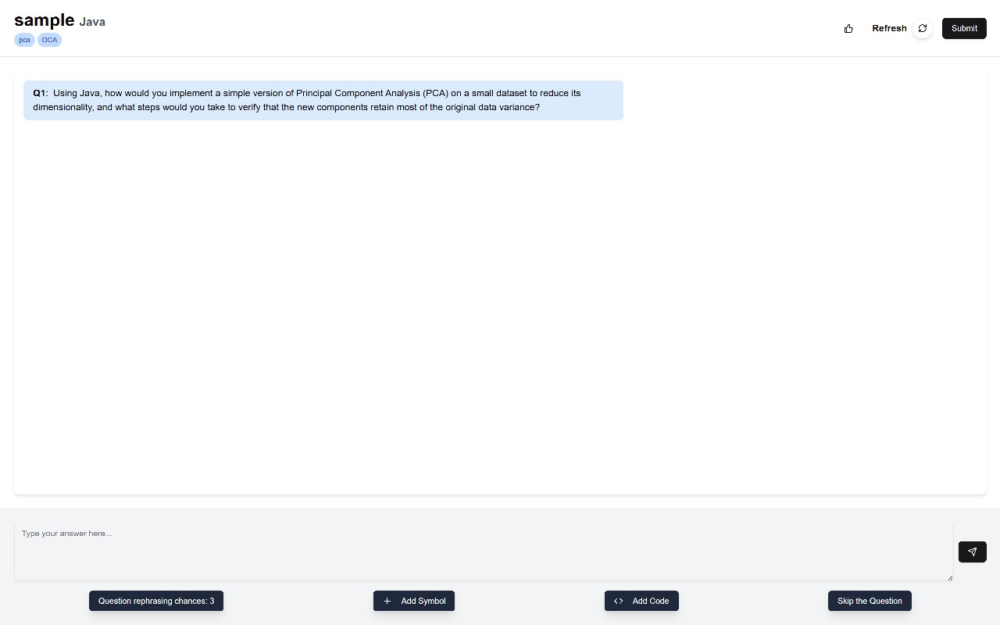

# SkillSage

SkillSage lets colleges run technical interview practice for an entire cohort while tailoring each student's questions to their résumé and previous answers. Students can revisit feedback on individual responses. Administrators can compare results across a batch to choose topics for the next practice session.



## From setup to feedback

1. A college administrator sets up batches, imports students from a roster and creates an interview. The administrator controls when students can start it.
2. A student uploads a Word résumé. The API extracts text with Mammoth, generates a short summary, and stores it with a reference to the uploaded file.
3. The API combines the résumé summary with the interview subject and topic to generate the opening question. It stores each exchange, evaluates the response and uses prior exchanges when requesting the next technical or coding question.
4. Students can type, dictate in browsers that support `webkitSpeechRecognition`, or submit code through the Ace editor. The API sends code responses for model feedback. The editor includes Python, Java, JavaScript, C/C++ and C# syntax modes.
5. Students can revisit their question-level feedback and overall assessment. Administrators can review participation, marks and performance across interviews.

## Inside the repository

| Component | Responsibility |
| --- | --- |
| `frontend/` | React, TypeScript and Vite client for administrators and students. Axios calls the API, Ace handles code input and Recharts renders performance charts. |
| `backend/src/controllers/` | Express handlers for rosters, résumé uploads, interview state, answers and feedback. |
| `backend/src/Api-helper/helper.ts` | OpenAI prompts for summarization, question generation and evaluation. The checked-in helper selects GPT-4o. |
| `backend/src/models/` | PostgreSQL schema defined with Sequelize. A shared interview sets the topics and question counts. Each student attempt has its own record and question–answer history. |
| `backend/doc/api-documentation.yml` | API reference to read alongside the route definitions in `backend/src/routes/`. |

## Local development

The client expects the API at `http://localhost:5000/api/v1`. Use a dedicated development PostgreSQL database. On startup, Sequelize synchronizes the model definitions with `alter: true`. AI-backed flows require your own OpenAI API key with access to the configured model.

Create `backend/.env` with your local values for the following settings.

| Settings | Purpose |
| --- | --- |
| `DB_HOST`, `DB_PORT`, `DB_NAME`, `DB_USER`, `DB_PASSWORD` | Address and credentials for the development database |
| `PORT` | Set to `5000` for the checked-in frontend |
| `COOKIE_NAME`, `COOKIE_SECRET`, `JWT_SECRET` | A cookie name and two independently generated signing secrets |
| `OPEN_AI_SECRET` | Server-side OpenAI key |

From the repository root, start the API in one terminal. Use a Node.js installation with npm and run in development mode for local HTTP.

```sh
cd backend
npm ci
npm run build
node dist/index.js
```

Start the client in a second terminal and open `http://localhost:5173`.

```sh
cd frontend
npm ci
npm run dev
```

Use a local test college and student account to exercise the interview flow. The repository also contains Dockerfiles and a Compose definition. Its backend bind mount covers the application's built directory inside the image, so the container setup needs adjustment for a fresh checkout.

## Team and college use

Four people built SkillSage over roughly a year. Baba Gandhi Kandagatla and one teammate co-developed the backend, and two teammates focused on the frontend.

The team reports **200–300 concurrent interviews** during internal college use. In a separate Playwright exercise, approximately **1,500 simulated sessions** progressed through different interview stages, issuing real GPT requests at staggered times. The figure measures concurrent sessions. The test scripts and measurements are unavailable in this repository.

## Reproducible load testing

A useful next step is to publish an anonymized Playwright scenario with the ramp-up schedule, session counts, error rate and response-time percentiles. That would make it possible to compare changes to the interview workflow under the same load.
